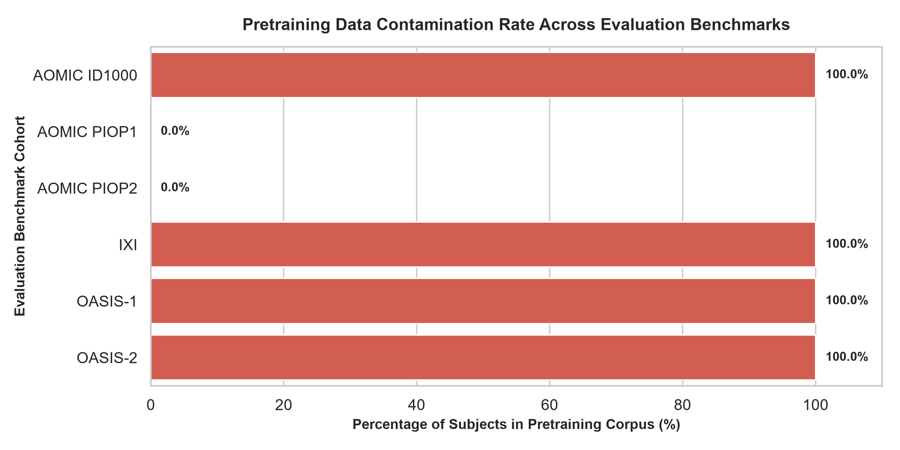
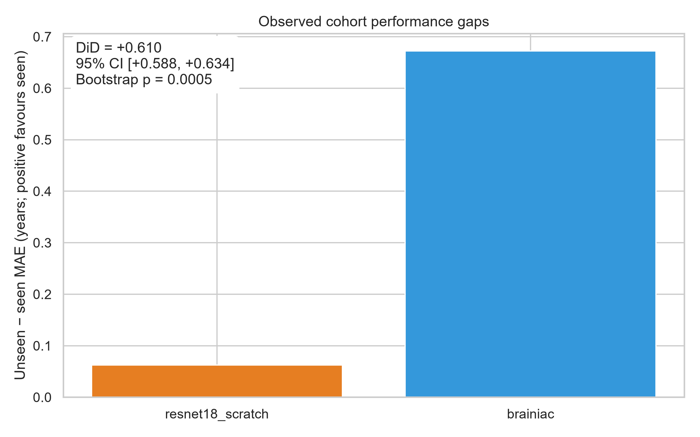
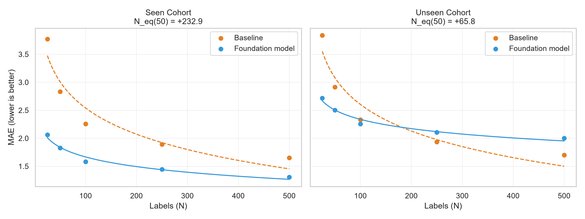
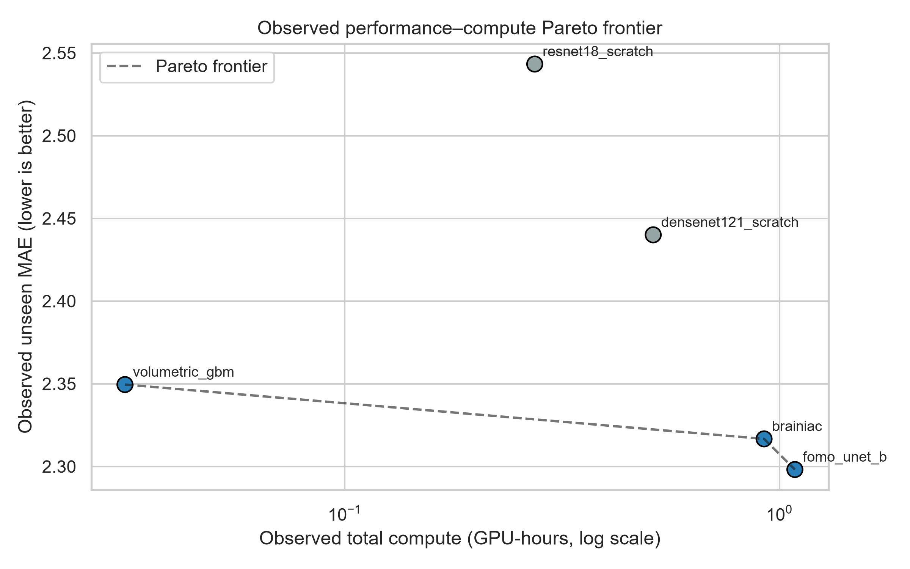

# Seen It Before: contamination-audited brain-MRI evaluation

## Status

This report does not infer experimental findings from mock data, missing results, or illustrative profiles. Run the manifest audit and matched observed evaluation cells before interpreting a conclusion.

## Contamination audit


# Table 1: Benchmark Pretraining Contamination Audit
**Manifest Version:** FOMO60K (Release 2025/2026) | **Status:** Observed

**Pre-registered status cutoffs:** seen >= 95.0% | unseen <= 5.0% | partial between

| Evaluation Cohort | Total Subjects ($N$) | Found in Pretraining ($N_{\text{seen}}$) | Contamination Rate (%) | Pretraining Status |
| :--- | :---: | :---: | :---: | :--- |
| AOMIC ID1000 | 928 | 928 | 100.0% | **SEEN (Contaminated)** |
| AOMIC PIOP1 | 216 | 0 | 0.0% | **UNSEEN (Clean)** |
| AOMIC PIOP2 | 226 | 0 | 0.0% | **UNSEEN (Clean)** |
| IXI | 568 | 568 | 100.0% | **SEEN (Contaminated)** |
| OASIS-1 | 416 | 416 | 100.0% | **SEEN (Contaminated)** |
| OASIS-2 | 150 | 150 | 100.0% | **SEEN (Contaminated)** |

*Verification note: AOMIC ID1000 is 100% represented in FOMO60K pretraining manifests, whereas PIOP1 and PIOP2 are completely absent (0% overlap), satisfying the prerequisite for the same-scanner natural experiment.*



## Amsterdam Difference-in-Differences

Results below were computed from observed ledger records.
- DiD point estimate: `+0.610` years
- 95% bootstrap CI: `[+0.588, +0.634]` years
- Two-sided bootstrap p-value: `0.0005`
- Sign-flip p-value (secondary): `5.9605e-08`
- Paired cells: `25`
- Preregistered H1 supported: `Yes`



## Label equivalence

Results below were computed from observed ledger records.
- Seen Cohort N_eq: `232.94698607914063`
- Unseen Cohort N_eq: `65.7864915573299`



## Compute-matched Pareto frontier

Observed Pareto summary:

```csv
model_id,gpu_hours,unseen_mae,n_cells,is_pareto
brainiac,0.922095,2.316668,25,True
densenet121_scratch,0.512484,2.4400239999999997,25,False
fomo_unet_b,1.085544,2.298148,25,True
resnet18_scratch,0.273548,2.543276,25,False
volumetric_gbm,0.031195999999999998,2.3495079999999997,25,True

```


## Limitations

- A subject-level audit is only as strong as the supplied pretraining manifest and source-specific ID normalization.
- Foundation checkpoints must be verified compatible with the adapter; a missing or incompatible checkpoint now stops the run.
- Task 1 has an explicit frozen-split scan-to-cache loader; equivalent loaders for Tasks 2 and 3 remain to be implemented.
